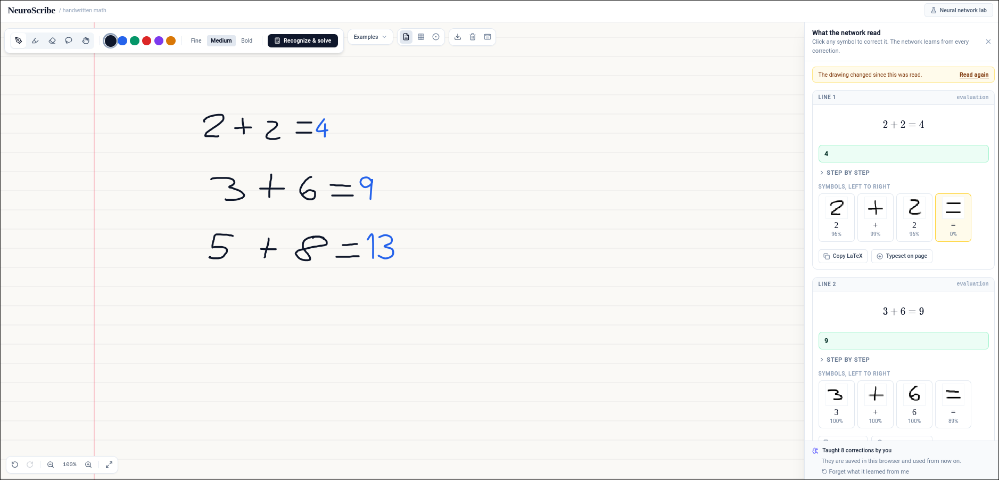
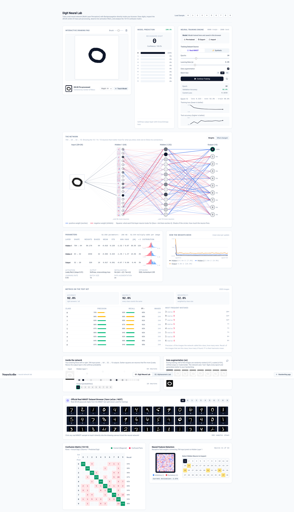

# NeuroScribe

Handwritten math on an infinite page, and a lab to look inside the neural networks that read it. The networks are multi-layer perceptrons written from scratch in TypeScript ([`src/ml/neuralNetwork.ts`](src/ml/neuralNetwork.ts)); everything runs **in your browser**, no cloud APIs and no ML libraries.

## About this project

NeuroScribe is a personal project I built to learn how neural networks and a handwriting-to-math pipeline work end to end, from the raw pixels to a solved equation.

> **Status: work in progress.** The project is live and usable, but it is still in development and there is a lot left to polish (recognition accuracy on some symbols, the layout analysis on messy handwriting, the solver's coverage and the UI). Expect rough edges.
>
> **Live demo:** https://baudahn.github.io/digit-recognizer/ · **Lab:** https://baudahn.github.io/digit-recognizer/lab.html

## Screenshots

**The app**: handwritten arithmetic is read, typeset and solved, and every symbol the network read is shown with its confidence so it can be corrected.



**The lab**: train a network in the browser and look inside it (network graph, parameters, weight dynamics, per-class metrics, confusion matrix, first-layer filters).



## Built with AI

**It was built mostly with AI.** Nearly all of the code was written by [Claude Code](https://claude.com/claude-code) (Anthropic's coding agent) working from my instructions. I did not hand-write most of it, and I would rather say so up front than leave you guessing. My part was the work around the code:

- **Defining the product**: what it should do, what "done" looks like, and which features are worth building (a canvas that reads layout, a lab to look inside the networks, learning from user corrections).
- **Setting constraints and direction**: 100% local, no cloud APIs, no ML libraries, networks written from scratch, and a clean separation between the app and the lab.
- **Reviewing and steering**: reading the output, running it, catching wrong turns, and asking for rework. The history shows this as incremental commits and a restructure of the codebase, not a one-shot dump.
- **Verification**: unit tests (Vitest), strict type checking and CI, so the code is checked by something other than the model that wrote it.

What I took away from it is how to direct an AI agent on a project of non-trivial size, and how to read and verify machine-written code, as well as the ML and math topics themselves.

### Highlights

- A **multi-layer perceptron written from scratch** in TypeScript (forward pass, backpropagation, momentum SGD), with no ML libraries.
- **Training that runs in the browser** (Web Workers) and **offline in Node** with the same code, data-parallel over CPU cores.
- A **handwriting pipeline**: stroke grouping, symbol recognition, 2D layout analysis (fractions, roots, sums, integrals, exponents), a parser written by hand (no `eval`), and a symbolic solver/differentiator/integrator.
- **On-device learning**: user corrections fine-tune the network, mixed with a replay of the original data to avoid forgetting, and are stored in IndexedDB.
- A **lab for inspecting networks**: weights, activations, learning curves, confusion matrix and per-class metrics.
- **Stack**: TypeScript, React 19, Vite, Tailwind CSS, KaTeX, Vitest, GitHub Actions.

## What it does

There are two separate pages:

| Page | For | What it is |
|---|---|---|
| **`/` the app** | people who want to write math | An infinite canvas. Write numbers, letters, Greek, `Σ`, `∏`, `∫`, `∂`, fractions, roots, exponents and indices; it reads them, typesets them as LaTeX and solves what can be solved. If it reads a symbol wrong you tell it what it was and the network **learns from the correction** for next time. |
| **`/lab.html` the lab** | looking inside the networks | The **Digit Neural Lab** and the **Alphanumeric Lab**: draw, train, and see the network as a graph, its parameters, how the weights move while it learns, and per-class metrics. |

## The app

- **Reads 160+ symbols**: digits, Latin letters, Greek, calculus (`∂ ∇ ∫ ∮ Σ ∏ ∞ √ Δ`), operators, relations, sets and logic, arrows, brackets (`Ctrl+K` lists them).
- **Reads the layout, not just the symbols**: fractions (a bar with something above and below), roots, sums and products with limits above and below, integrals with limits, exponents and indices. Several lines written one under the other are read separately.
- **Typesets and solves**: LaTeX of everything it reads; arithmetic, linear and quadratic equations, sums and products with numeric limits (`Σ i² = 14`, with the terms written out), polynomial integrals (definite ones numerically otherwise), symbolic derivatives (`d/dx`, `∂/∂y`), functions of one variable are plotted. What it cannot compute it still typesets.
- **Definitions across lines**: write `swish(x) = xσ(βx)`, then `y = swish(x)`, then `∂y/∂x =` and the third line is differentiated using the first two, in any order on the page. `σ(…)` is the sigmoid (also built in: `tanh`, `sinh`, `cosh`, `softplus`, `swish`). Partial, mixed (`∂²f/∂x∂y`) and higher-order derivatives treat the other letters as constants, and the steps name the rules used (product, quotient, chain, σ′ = σ(1−σ)).
- **Symbolic integrals**: sums and constant multiples, powers, `1/(ax+b)`, `1/(1+x²)`, `eˣ`, `sin`, `cos`, `ln`, `σ`, `tanh`…, polynomial × `eˣ`/`sin`/`cos` by parts, and `f(g(x))·g′(x)` by substitution. When there is no elementary form and the limits are numbers, it integrates numerically.
- **Teach it**: after recognizing, click any symbol (on the page or in the panel) and say what it really was. The correction becomes a training example; the network is fine-tuned in a Web Worker together with a replay of its original training data (so it does not forget the rest) and saved in IndexedDB. "Forget what it learned from me" goes back to the shipped model.
- **Keyboard**: `Ctrl+Z` undo, `Ctrl+Shift+Z` / `Ctrl+Y` redo, `Enter` or `Ctrl+Enter` recognize, `P M E L H` tools, `1 2 3` pen width, `Space` to pan, `Ctrl+A`, `Delete`, `Ctrl +/-/0` zoom, `Ctrl+S` save as image, `?` for the full list. The page is saved in the browser.

## Getting started

```bash
npm install
npm run dev        # http://localhost:5173  (app)  and  http://localhost:5173/lab.html  (lab)
```

```bash
npm test           # unit tests (Vitest)
npm run lint       # type checking
npm run build      # production build in dist/ (both pages)

npm run build:datasets   # public/datasets/mnist-*, emnist-* (lab)
npm run build:symbols    # the dataset of the math network: .cache/symbols and public/datasets/symbols-*
npm run train:models     # re-train the digit and letter models
npm run train:models math   # re-train the math model (parallel, ~1 hour on 14 cores)
```

The dataset scripts download MNIST (≈ 11 MB), EMNIST (≈ 560 MB, needs `unzip`) and, for the math network, [HASYv2](https://zenodo.org/records/259444) (≈ 34 MB, see the top of `scripts/build-symbols.ts`) into `.cache/` (git-ignored). The results are committed, so you only need them to change the data or retrain.

## The math network

`public/models/math.json`: **784-512-256-163**, Leaky ReLU, softmax, trained with momentum SGD (data-parallel over CPU cores, see `scripts/lib/parallelTrainer.ts`) on about 200,000 images:

| Source | Used for |
|---|---|
| MNIST | digits |
| EMNIST ByClass | upper and lower case letters (look-alike pairs such as c/C, x/X are one class) |
| HASYv2 (Thiemann, 168k handwritten symbols) | Greek, calculus, relations, sets, arrows, brackets… |
| Generated strokes (`src/ml/syntheticSymbols.ts`) | `= ( ) ! < > + - /`, which HASY lacks or has too few of |

Everything is normalized like MNIST (`src/ml/imageOps.ts`): the ink is cropped, scaled into a 20×20 box and centered by center of mass in 28×28. Flat shapes (`-`, `=`, dots) lose their size that way, so they are told apart by geometry before the network sees them. The accuracy on the held-out test split is in the model file (`meta.testAccuracy`) and shown in the lab.

## How a line is read

```
strokes ─► symbols ─► layout ─► text for the parser ─► tree ─► answer
  group     28×28      frac/√/Σ     "Σ_(i=1)^(4)i^(2)"    evaluate / solve /
  strokes   network    ^ _ limits                         differentiate / integrate
                          └──────► LaTeX (what is shown)
```

1. **Grouping** (`src/ml/strokeRecognizer.ts`): strokes that touch or cross belong together; the bars of `=`, the dot of `i` and `÷` are special cases.
2. **Layout** (`src/ml/mathLayout.ts`): fraction bars, radicals, big operators with limits and exponents/indices are found from the bounding boxes alone, so correcting one symbol just re-runs the layout.
3. **Math** (`src/ml/mathParser.ts`, `mathAst.ts`, `mathSolver.ts`, `mathCalculus.ts`): a tokenizer and recursive-descent parser (no `eval`), evaluation, step-by-step simplification, equation solving and symbolic calculus.
4. **Learning** (`src/ml/userModel.ts`, `mathModel.ts`, `learner.worker.ts`): fine-tuning from corrections.

## The lab

Open `/lab.html`. Both labs share these views of the network:

- **The network**: input image, both hidden layers and the outputs as a graph. Circles are shaded by how much each neuron fires for what you drew; the squares are what each first-layer neuron looks for; connections are blue (excite) or red (inhibit). "What changed" highlights the connections that moved most in the last update, live while it trains. Click a neuron to follow its connections.
- **Parameters**: parameter count and size per layer, mean, standard deviation, range, norm, share of near-zero weights, histogram of the weights, and the hyperparameters.
- **How the weights move**: mean |Δw| per layer at each update.
- **Metrics**: accuracy, macro and weighted F1, precision/recall/F1 per class and the most frequent mistakes.

The Digit Neural Lab also has the learning curves, confusion matrix, the activation of every neuron, the first-layer filters, a gallery of MNIST digits and data augmentation. The Alphanumeric Lab segments several characters, classifies them with a network trained on EMNIST Balanced and, for comparison, with hand-written rules.

## Project structure

```
src/
  app/        the handwriting app (canvas, recognition panel, corrections, shortcuts)
  lab/        the lab (digit lab, alphanumeric lab, shared insight views)
  ml/         networks, preprocessing, layout, math engine, learning: no React, unit-tested
scripts/      dataset builders and offline training (Node, same code as the browser)
public/       datasets and pre-trained models served as static files
index.html    the app          lab.html    the lab
```
